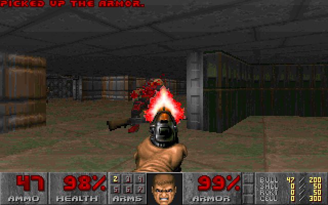

# nandfs

A computer made of folders. Every NAND gate is a directory, every wire is a
symlink, and a small FUSE filesystem supplies the physics: it knows what a
NAND gate and a D flip-flop do, and nothing else.

There are two machines in this repository:

- A CHIP-8 in which everything is folders, including the CPU, the 4 KB of
  RAM, the stack, the timers, the 64×32 screen and the font. It plays Pong in
  your terminal, in real time.
- A RISC-V CPU (PicoRV32, as 22,677 NAND gates and 2,035 flip-flops) that
  runs DOOM. It takes two or three minutes per frame.


*20 seconds of Pong, read from the mounted folders at real speed. A script
plays the left paddle by pressing the key pins; the right one is the game's
own.*



*Frame 120 of DOOM's first demo, six hours in. Byte for byte the same as the
frame from the C reference model.*

You can look inside the machines with `ls`, follow a wire with `readlink`,
rewire one with `ln -sf` and break it with `rm`, while it runs:

```
$ cd ~/nandfs-build/mnt
$ ls chip8
buzzer      clockgen  display  icount.bus  keys      memory  pins
buzzer.bus  cpu       icount   in          keys.bus  out
$ cat chip8/cpu/pc
594
$ ls chip8/memory/ram/h2/h0/h1          # the byte at 0x201
dout_0.nand  g0.nand   g2.nand   g27.nand  g35.nand  g6.nand  q_2.dff
dout_1.nand  g10.nand  g20.nand  g28.nand  g36.nand  g8.nand  q_3.dff
dout_2.nand  g12.nand  g21.nand  g29.nand  g37.nand  in       q_4.dff
dout_3.nand  g14.nand  g22.nand  g30.nand  g38.nand  out      q_5.dff
dout_4.nand  g16.nand  g23.nand  g31.nand  g39.nand  q        q_6.dff
dout_5.nand  g17.nand  g24.nand  g32.nand  g4.nand   q.bus    q_7.dff
dout_6.nand  g18.nand  g25.nand  g33.nand  g40.nand  q_0.dff
dout_7.nand  g19.nand  g26.nand  g34.nand  g41.nand  q_1.dff
$ cat chip8/memory/ram/h2/h0/h1/q       # Pong starts with 00E0, clear screen
224
$ cd chip8/cpu/regs/v3
$ readlink q_0.dff/d                    # where bit 0 of V3 gets its input
../g3.nand/out
$ readlink g3.nand/a g3.nand/b
../g1.nand/out
../g2.nand/out
$ find ~/nandfs-build/mnt/chip8 -name '*.nand' | wc -l
327027
```

## Running it

Linux (Debian or Ubuntu; elsewhere, install the packages listed in
`scripts/setup.sh` yourself):

```sh
git clone https://github.com/zero11-0203/nandfs && cd nandfs
scripts/setup.sh        # installs yosys, iverilog, libfuse3 etc. and builds
scripts/play.sh         # Pong: keys 1 and q move your paddle, Esc quits
```

The first build synthesizes the Verilog with Yosys (about 10 seconds) and
writes 1.2 million folders and symlinks (about a minute). They go in
`~/nandfs-build` (set `NANDFS_BUILD` to change that), which should be on a
local disk. It takes about 3.3 GB, nearly all of it directory blocks. While a
game runs, the machine is mounted at `~/nandfs-build/mnt`, so you can poke
at it from another shell. The screen is drawn with two pixel rows per
character:

```
┌────────────────────────────────────────────────────────────────┐
│                        ▄▄▄▄          ▄                         │
│                        █  █         ▀█                         │
│                        █▄▄█         ▄█▄                        │
│                                                                │
│                                                                │
│                                                             ▄  │
│  ▄                                                          █  │
│  █                                                          █  │
│  █                                                          ▀  │
│  ▀                  ▄                                          │
│                                                                │
│                                                                │
│                                                                │
│                                                                │
│                                                                │
│                                                                │
└────────────────────────────────────────────────────────────────┘
 23.0 kHz   600 instr/s      83 gates/tick     Esc quits
```

Other games: `scripts/play.sh build/games/br8kout.ch8` (`setup.sh` fetches a
dozen from the CHIP-8 archive). The keypad is the usual one:

```
1 2 3 4        1 2 3 C
q w e r   ->   4 5 6 D
a s d f        7 8 9 E
z x c v        A 0 B F
```

For DOOM, see [docs/rv32.md](docs/rv32.md): `scripts/setup.sh
rv32`, then `scripts/run-doom.sh`, then come back in ten days.

macOS works too, with macFUSE (tested with 4.10.1 on Apple Silicon). Both
machines run and pass their tests. Yosys isn't needed on the Mac if you copy
the netlists (`~/nandfs-build/net/*.json`) from a Linux build. The Linux path
is the better-tested one, and a Linux VM on a Mac works fine.

## Things to try while a game is running

Pull a wire out of the CPU and watch the game go wrong, then put it back:

```sh
cd ~/nandfs-build/mnt/chip8/cpu/regs/v2     # V2 is the ball's x position
readlink q_0.dff/d                          # ../g3.nand/out
rm q_0.dff/d                                # bit 0 of V2 now reads 0
```

The ball now moves left two columns at a time, and can't move right at all:
adding 1 to an even column sets bit 0, which is gone by the next tick. It
also starts leaving a trail, which stays after you repair the wire.
`.ctl/stats` shows `broken_wires 1`. Put it back with
`ln -s ../g3.nand/out q_0.dff/d`.

After an edit the daemon reads the whole tree again, which takes a few
seconds, so the effect is not instant.

Flip a bit of RAM: `echo 1 > chip8/memory/ram/h2/h3/h0/q_6.dff/q`.

Jump back to the start of the program: `echo 512 > chip8/cpu/pc`.

See what the machine is doing: `cat .ctl/stats` shows the tick rate and how
many gates were evaluated per tick. Write `1` to `.ctl/profile`, wait, and
read it back to see which folders are busiest.

## The rules

The point is that the folders are the computer, so the daemon has to be kept
honest. These are the rules it follows:

1. The only built-in behavior is:
   - `X.nand/`: a folder with two symlinks, `a` and `b`. Its file `out`
     reads `NAND(a, b)`.
   - `X.dff/`: a folder with one symlink, `d`. Its file `q` takes the value of
     `d` on every clock tick.
   - `vcc/out` is 1, `gnd/out` is 0, and an input pin `X.pin/value` is a file
     you write.
2. No hidden memory. The RAM, registers, stack, timers, screen and font are
   all flip-flops, or for the font, gates wired to `vcc` and `gnd`.
3. The simulator knows nothing about CHIP-8 or RISC-V. `fs/nandfs.c` is
   1,215 lines, `tests/integrity.sh` checks that it never names any part of a
   machine, and the same binary runs everything.
4. The only inputs from outside are the clock and the keys. The 60 Hz timers
   and the instruction rate come from counters, built of gates, that divide
   the master clock.

The flip-flop primitive is there for speed. `tools/demos.py` builds a
flip-flop out of nine NAND gates and the tests check that it behaves the same
as the primitive, tick for tick.

There are some conveniences, listed here so nobody has to find them:

- Loading a game writes the `init` files of the RAM flip-flops and resets
  the machine. That's flashing a ROM.
- The viewer reads the screen flip-flops to draw the display.
- `X.bus/` folders (symlinks named `0`, `1`, `2`, ...) read a group of
  signals as one number, so `cat chip8/cpu/pc` prints `512` and not twelve
  separate bits. The machines never read them; they are for people.
- The current value of every gate and flip-flop lives in the daemon's
  memory, one bit per folder, the way a real flip-flop holds a charge. It is
  not saved when you unmount. You can read and write it through `out` and `q`.
- The RISC-V machine bends rule 2: 16 MB of RAM as flip-flops would be about
  a billion folders, so its RAM and ROM are a third primitive, `X.mem/`, a
  file of words with an address, data and write enables wired in by
  symlinks. Everything else in that machine is gates and flip-flops.
  Details in [docs/rv32.md](docs/rv32.md#the-rule-change).

The obvious objection: the daemon doesn't actually follow the symlinks every
time it evaluates a gate. That's true. It reads the tree into arrays and
re-evaluates only the gates whose inputs changed, like any logic simulator.
But the folders are the only description of the circuit it has. Any `rm`,
`ln` or `mkdir` makes it read them again, and the machine changes
accordingly. An earlier version that followed the symlinks on disk for every
evaluation gave the same results and was far too slow to run either CPU.

## How it works

```
hw/chip8/      the CHIP-8, in Verilog
hw/rv32/       the RISC-V machine: a wrapper around PicoRV32
scripts/       setup, build, play, fetch third-party code
fs/            the FUSE daemon
tools/         netlist to folders, reference models, assembler, loaders
viewer/        the terminal display and keypad; DOOM runner and web player
sw/            runtime, DOOM port and tests for the RISC-V machine
tests/         every layer checked against the one below it
roms/          Pong and test programs for the CHIP-8
docs/          longer explanations
```

`hw/chip8/chip8.v` describes the machine. Yosys turns it into nothing but
NAND gates and rising-edge D flip-flops, keeping the module hierarchy.
`tools/netlist2folders.py` writes each module instance as a folder, each gate
as a `.nand` folder and each wire as a relative symlink.

The daemon passes everything through to the backing directory except the
files it computes (`out`, `q`) and a control folder, `.ctl/`. Write a number
to `.ctl/clock` to step that many ticks, or a frequency to `.ctl/run` to
run in real time.

A tick only costs the gates that actually change, so the hardware is
designed to change as little as possible. The obvious way to write 4 KB of
RAM in Verilog gives a flat decoder where a single access touches about
27,000 gates. Here the RAM is a tree of 16-way nodes that passes the address
and data only to the selected child, and an access touches about 850. Pong
averages about 85 gate evaluations per tick.

More in [docs/internals.md](docs/internals.md) and
[docs/chip8.md](docs/chip8.md).

## Numbers

| | CHIP-8 | RISC-V |
|---|---|---|
| NAND gates | 327,027 | 22,677 |
| D flip-flops | 35,251 | 2,035 |
| Memory | 4 KB, in flip-flops | 16 MB RAM + 8 MB ROM, in two `.mem` files |
| Folders / symlinks | 397,832 / 811,680 | 24,882 / 50,211 |
| Clock | 23,040 Hz (720 instructions/s, 60 Hz timers) | free running, about 33,000 ticks/s |
| Speed | real time; unthrottled, about 730,000 ticks/s (32×) | about 7,500 instructions/s, under 3 minutes per DOOM frame |

## How it's tested

Each layer is checked against the one below it.

1. Gates: exhaustive truth tables for XOR, the full adder and the 8-bit adder
   (all 65,536 sums). The NAND-built flip-flop and shift register match the
   primitive ones on every tick, and `.mem` matches a model.
2. The Yosys pipeline: a small Verilog design (an adder and a counter) turned
   into folders matches a model of the Verilog.
3. `tests/integrity.sh`: the simulator names no part of any machine.
4. Verilog against a reference model, instruction by instruction. For the
   CHIP-8, `tools/chip8ref.py` and 14 programs, including Timendus' test
   suite and Pong. For RISC-V, `tools/rvref.c` and riscv-tests rv32ui and
   rv32um plus two tests of our own, 50 programs.
5. The mounted folder machines against the same reference models, on the
   same programs, reading every value through files.
6. DOOM: every frame the folder machine draws is compared byte for byte with
   the reference model's.

`tests/run_all.sh` runs the CHIP-8 checks and `tests/run_rv32.sh` the RISC-V
ones.

## Limitations

- A structural edit is picked up once edits pause for 0.2 s, and re-reading
  1.2 million entries takes a few seconds.
- The CHIP-8 waits for the display like a COSMAC VIP, so games written for
  modern interpreters run slowly.
- Terminals report key presses but not releases, so a key counts as held for
  0.3 s after each press.
- DOOM is not playable in any useful sense.

## License

MIT, see [LICENSE](LICENSE). Nothing third party is included. These scripts
fetch it, at pinned versions:

- `scripts/fetch-roms.sh`: Timendus' CHIP-8 test suite (GPL-3.0)
- `scripts/fetch-games.sh`: games from John Earnest's CHIP-8 archive (CC0)
- `scripts/fetch-picorv32.sh`: PicoRV32 (ISC)
- `scripts/fetch-riscv-tests.sh`: riscv-tests (BSD-3-Clause)
- `scripts/fetch-doom.sh`: doomgeneric (GPL-2.0) and the shareware DOOM WAD
